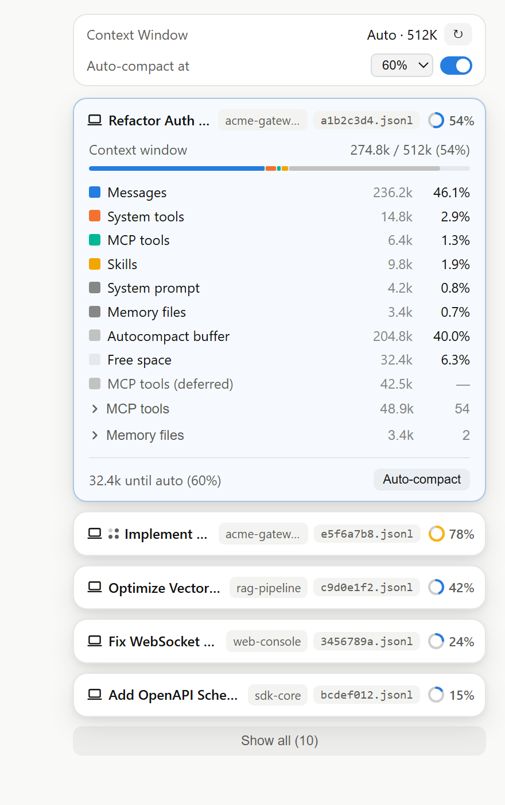

# agy-context-ring

**Real-time context window ring, token breakdown, and idle-guarded auto-compact sidecar plugin for Google Antigravity.**

`agy-context-ring` brings an interactive, multi-session context-window monitor directly into Antigravity's Auxiliary Side Pane. It tracks live token usage across your active and recent Antigravity conversations, breaks down exact context overhead (`Messages`, `System tools`, `MCP tools`, `Skills`, `System prompt`, `Memory files`, `Autocompact buffer`, `MCP tools (deferred)`), and safely triggers `/compact` only when an agent turn finishes and transitions to idle.

<p align="center">
  
</p>

---

## Features

- **Multi-Session Live Monitoring**
  - Automatically discovers running (`RUN_STATE_RUNNING`) and recent Antigravity conversations via `ConversationService/ListConversations` (with local `brain/` fallback).
  - Always pins the current conversation at the top with a subtle accent highlight, shows Antigravity's 2×2 running indicator for active agents, displays 5 sessions by default (expandable up to the 10 most recent conversations), and uses visibility-aware polling + `BroadcastChannel` sync so multiple panes never saturate HTTP/1.1 connection limits.
- **Exact Real-Time Token Breakdown**
  - Reads `PLANNER_RESPONSE` (`input_tokens + cache_read_tokens + output_tokens`) from each session's `transcript.jsonl`.
  - Measures actual local environment overhead on disk:
    - **Skills**: Frontmatter metadata injected from `~/.gemini/config/plugins/*/skills/*/SKILL.md` and builtin skills.
    - **Memory files**: Active `AGENTS.md` rule files with expandable per-file token counts.
    - **MCP tools & deferred schemas**: Scans `~/.gemini/antigravity/mcp/<server>/*.json` for deferred tool counts and schema sizes, with an expandable per-server breakdown.
    - **Messages**: Remainder of real billed tokens after overhead, so the breakdown always sums to the exact session total.
- **Model-Aware `Auto` Window & Idle-Guarded Auto-Compact**
  - Always follows Antigravity's real underlying per-model context limit (`512K` for Gemini 4 Neon/Hydrogen/Carbon/Argon, `840K` for Claude Opus/Sonnet 5.5, `256K` for Gemini 3.8 Flash, `128K` for Gemini 2.5) with configurable auto-compact threshold (`50%`–`90%`, default `60%`).
  - **Turn-safe compaction**: While an agent is actively running (`RUN_STATE_RUNNING`), the `Auto-compact` button is disabled (`cursor: not-allowed`) with a `"Cannot compact while the agent is running"` tooltip.
  - When Auto-compact is enabled and an active conversation exceeds the threshold, `/compact` is dispatched via `LanguageServerService/SendUserCascadeMessage` (`SLASH_COMMAND_TYPE_SYSTEM`) **the moment the turn transitions to idle**, protected by a persistent step lock (`compact-state.json`), `CHECKPOINT` detection, and a 180-second cooldown so it never loops.
- **One-Click History Path Copy**
  - Each session header displays its workspace folder pill (non-clickable) and `<shortId>.jsonl` pill. Clicking the `.jsonl` pill copies the relative path `.gemini/antigravity/brain/<conversationId>/.system_generated/logs/transcript.jsonl` to your clipboard.
- **Zero External Dependencies**
  - Pure Node.js HTTP + SSE backend (`server.cjs`) and self-contained HTML/CSS/JS frontend (`ui.html`).

---

## Installation

1. Clone this repository into your Antigravity plugins directory:

```bash
git clone https://github.com/Wang-auspicious/agy-context-ring.git ~/.gemini/config/plugins/claude-context-ring
```

*(Or on Windows PowerShell:)*

```powershell
git clone https://github.com/Wang-auspicious/agy-context-ring.git "$env:USERPROFILE\.gemini\config\plugins\claude-context-ring"
```

2. In Antigravity, open **Customizations → Plugins** (or click the **+** menu in the right Auxiliary Side Pane) and open **Context Ring**.

---

## Architecture

```text
├── plugin.json                        # Antigravity plugin manifest
└── sidecars/
    └── context-ring/
        ├── sidecar.json               # AUX_PANE webview registration
        ├── ui.html                    # Self-contained ring, segmented bar & accordion UI
        └── dist/
            └── server.cjs             # Zero-dep Node HTTP + SSE server (non-blocking cache)
```

### How It Works

1. `server.cjs` binds to `127.0.0.1:$ANTIGRAVITY_SIDECAR_WEB_PORT`, serves `/ui.html`, `/preload.js`, `/api/context`, `/api/events` (SSE), `/api/settings`, and `/api/compact` with `Cache-Control: no-store`.
2. Background polling refreshes `ConversationService/ListConversations` and workspace metadata without blocking HTTP responses, while `transcript.jsonl` parsing is cached by file `mtimeMs`.
3. When `autoCompactEnabled` is on and a session's `totalTokens >= windowSize * (thresholdPct / 100)` while `RUN_STATE_IDLE`, `server.cjs` executes `agentapi send-message <conversationId> "/compact"`.

---

## License

MIT
